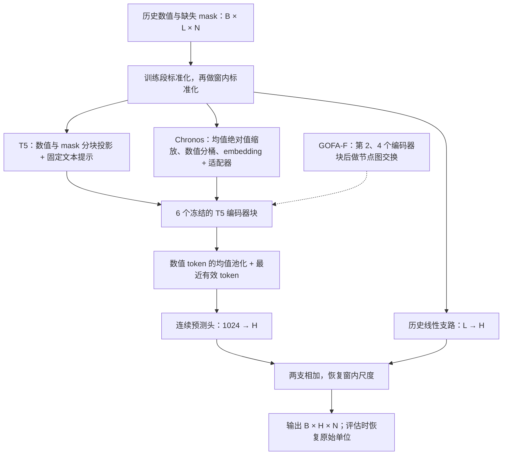

# 骨干运行流程、可训练参数与协议 v2

最新长度与后续模型设计已在 [下一阶段协议](NEXT_STAGE_PROTOCOL.md) 更新。
当前开发默认采用此前最短历史任务配对的 H：12/3/6/12/8/3；
本文的 12/24/48 扩展和原编码器流程保留为历史说明。

日期：2026-10-14。用户要求每个数据集使用已发表工作中的最短历史，并优先使用可核验的物理图，
或与学习图结合。旧首轮已按最新要求立即停止，不再等待 GOFA-F(Chronos) 完成；不启动新训练或测速。
本次只修订开发代码、配置和新图文件，保留现有数据、权重和环境。

## 当前实现的公共流程

输入为 `values[B,L,N]` 与自然观测 mask。`L` 是历史长度，`N` 是节点数。
先使用训练段每节点均值/标准差标准化；无训练观测节点使用训练段汇总统计回退。
模型内部再按每条历史窗的有效观测计算均值/标准差，得到窗内标准化序列 z。
未来目标不参与这些统计。

这里图层配置 `[1,3]` 是零起始索引，实际位于第 2、4 个编码器块之后。
两个骨干的 encoder 都是 6 层、隐藏维度 512、FFN 维度 2048、8 个注意力头。
冻结权重不会切断输入梯度；适配器和层间图模块的梯度仍穿过后续编码器。
首轮启用梯度检查点，反向时重算部分前向操作以节省显存。

## T5-small 的两个层面

原始 T5 是文本到文本的 encoder-decoder 语言模型，预训练学习文本表示，任务微调后可用于翻译、
摘要、问答等。T5-small 完整模型约 60M 参数。
本项目仅加载 `T5EncoderModel`，不加载生成解码器。
来源：[T5 论文](https://jmlr.org/papers/v21/20-074.html)、
[官方模型卡](https://huggingface.co/google-t5/t5-small)。

本项目中，z 和 mask 以每 12 个时间步分块，每块拼成 24 维向量，经 `Linear(24,512)` 投影。
固定英文提示由文本 tokenizer 得到 10 个 token，和数值 patch token 拼接。
首轮 L=96 时有 8 个数值 patch，共 18 个 token/节点。
Transformer 内部将 B 和 N 合并，每个节点的时间序列独立做时间注意力；图模块再显式交换节点信息。
最终只池化数值 token，提示 token 不直接进入池化，但会在编码器自注意力中影响数值 token。

输出端拼接数值 token 均值与最近有效数值 token，形成 1024 维特征。
经过 LayerNorm、Dropout、`Linear(1024,H)`，并加上 `Linear(L,H)` 的历史线性预测。
得到的是连续值预测，不是自然语言生成。现有数值任务不能证明语言语义能力的因果贡献。

## Chronos-T5-small 的两个层面

原始 Chronos 将数值序列缩放并量化成有限词表 token，以语言模型交叉熵目标进行时序预训练。
原生预测经过 encoder 与自回归 decoder，采样未来 token、反量化并恢复尺度，产生概率预测。
完整 Chronos-T5-small 约 46M 参数；它使用语言模型架构，不等于自然语言聊天模型。
来源：[Chronos 论文](https://arxiv.org/abs/2403.07815)、
[官方仓库](https://github.com/amazon-science/chronos-forecasting)。

本项目仍只加载 encoder。对公共流程得到的 z，再按有效观测的均值绝对值缩放，仅用于数值分桶。
缺失位置使用 PAD，末尾加入 EOS。首轮 L=96 时共有 97 个 token/节点。
固定 token embedding 后加入 `Linear(512,512)` 的残差适配器，再进入同样的 6 层编码器。
数值池化排除 EOS，后续使用与 T5 相同的连续预测头和历史线性支路。
该头直接学习连续值，不经过原生未来 token 采样/反量化过程。
因此当前结果是“预训练编码器＋监督适配”，不是原始 Chronos 的原生零样本成绩。

97/18 的 token 差异仅适用于旧首轮 L=96；新短历史会改变这一比例。
总参数更少不保证运行更快，因为实际 encoder 的宽度、深度相同，而序列长度不同。

## 图模块参数精确来源

对每个对齐的历史 token，图模块先 LayerNorm 和降维，再按邻接权重与有效 mask 归一化聚合，
经过 GELU 与升维，最后使用 `tanh(gate)` 控制残差消息。
门控初始为 0，保证配对模型初始输出一致。图权重矩阵本身目前是固定 buffer，不是可训练参数。
当前训练相关图是数据推断图，不是端到端学习边权的图。

每个图交换层（隐藏维度 512，rank=64）：

|组件|计算|参数量|
|---|---:|---:|
|LayerNorm 的缩放与偏置|512+512|1,024|
|无偏置降维投影|512×64|32,768|
|无偏置升维投影|64×512|32,768|
|标量门控|1|1|
|单层合计||66,561|
|两层合计||133,122|

Dropout、GELU、邻接矩阵和缺失 mask 都不增加可训练参数。
首轮 L=96、H=12 下其余可训练参数：

|组件|T5|Chronos|
|---|---:|---:|
|输入适配器|24×512+512=12,800|512×512+512=262,656|
|输出 LayerNorm|2×1024=2,048|2,048|
|输出线性头|1024×12+12=12,300|12,300|
|历史线性支路|96×12+12=1,164|1,164|
|无图合计|28,312|278,168|
|加两层图模块后|161,434|411,290|

新历史长度会改变历史线性支路的参数量；133,122 的图模块增量保持不变。
该增量来自消息变换与门控，不是新增传感器 ID embedding，也不是解冻骨干。

## 更快与跨数据集候选

Chronos-Bolt 是首选速度候选：分块编码、直接多步分位数输出，避免原始 Chronos 的逐步 token 采样。
官方报告最高约 250 倍推理加速，但比较对象是原生预测流程，不能套到本项目编码器适配的训练耗时。
Bolt-mini 完整约 21M、small 约 48M，适合在后续核对规模后评估。此次未下载或运行新权重。
来源：[官方实现与模型表](https://github.com/amazon-science/chronos-forecasting)。

固定一个 checkpoint 即可跨数据集原生预测的公开骨干还包括 Moirai、TimesFM、TiRex 和 Chronos-2。
Moirai 支持可变变量数；TimesFM 的具体版本应固定（当前官方已发布 3.0）；TiRex 的原始模型为
35M xLSTM 骨干，也提供零样本预测，结构与当前 T5 交织实现不同。
这些模型的泛化能力有论文/官方基准支持，但不能预先保证它们在本项目六个数据集上都最优或最快。
来源：[Moirai/Uni2TS](https://github.com/SalesforceAIResearch/uni2ts)、
[TimesFM](https://github.com/google-research/timesfm)、[TiRex](https://github.com/NX-AI/tirex)。

GNN 相关工作中，OpenCity 将 Transformer 与图神经网络结合，发布了 Plus/Base/Mini 权重，
支持同一权重在不同交通数据上的零样本预测。其证据主要是交通/城市时空数据，不能扩展成已证明
对空气质量和能源都适用；其窗口、时间特征及图要求也需另行适配。
来源：[OpenCity 官方代码与权重](https://github.com/HKUDS/OpenCity)。
TSGFM（CNSM 2025，Time Series Graph Foundation Model）明确研究 GNN 零样本多变量时序预测，
可作为跨域图模型论文候选；本轮尚未核验可用预训练 checkpoint 与本项目领域覆盖，不列作已接入基线。
不要将它与 CurryTang/TSGFM 的 Text-Space Graph Foundation Model（节点分类方向）混淆。
来源：[CNSM 论文 DOI](https://doi.org/10.23919/CNSM67658.2025.11297447)。

“共用基础模型权重”和“共用整个监督预测器的最终 checkpoint”不同。
本项目各数据集分别训练适配器/图层/预测头，历史线性层依赖 L、邻接 buffer 依赖 N，
因此目前没有实现一个完整 GOFA-F checkpoint 跨六数据集零样本预测。
验证该目标应增加留数据集/留领域训练与测试，统一可变长度预测头与外部图输入，禁止测试集参与权重选择，
并审计预训练语料是否已包含目标数据。无目标微调不自动等于目标数据未见过。

## 协议 v2：最短已核验历史与图优先级

完整可机读出处保存在 `configs/protocol_sources.yaml`。
“最小”指本次审计的正式预测工作中的最小值，不声称穷尽全部文献；不把插补窗口当作预测历史，
也不把不同采样率、节点版本或预测步长混为完全复现。

|数据集|历史步数|实际跨度|出处|新默认图|
|---|---:|---|---|---|
|METR-LA|12|1 小时|DCRNN 官方 seq_len=12|已对齐的道路距离图|
|PeMS-BAY|12|1 小时|StemGNN 官方表 window_size=12|已对齐的道路距离图|
|AQI / PM2.5-437|24|24 小时|ICML 2024 时空降采样预测，附录 Table 3|站点地理距离图|
|AQI-36 / PM2.5-36|12|12 小时|PriSTI IV-C，下游预测 12→12|站点地理距离图|
|Electricity|8|8 小时|TSDE，确定性 Electricity 实验与附录 Table 13 的 8→8|训练相关图|
|Solar-Energy|24|4 小时|StemGNN 附录 D，10 分钟采样、4 小时历史|训练相关图|

出处：[DCRNN 配置](https://github.com/liyaguang/DCRNN/blob/master/data/model/dcrnn_la.yaml)、
[StemGNN 官方表](https://github.com/microsoft/StemGNN#training-and-evaluation)、
[ICML 2024 论文](https://proceedings.mlr.press/v235/marisca24a.html)、
[PriSTI](https://arxiv.org/pdf/2302.09746)、[TSDE](https://arxiv.org/pdf/2405.05959)、
[StemGNN 附录](https://papers.nips.cc/paper_files/paper/2020/file/cdf6581cb7aca4b7e19ef136c6e601a5-Supplemental.pdf)。
Electricity 的短历史出处使用 TimesNet 处理的小时级 Electricity；仍需区分准备版本和划分。
保留本项目 H=12/24/48 属于对这些历史长度的协议扩展，不冒充每篇论文的原始预测设置。

当前 `configs/benchmark.yaml` 改为上述新协议；旧 96 步配置保留为 `configs/benchmark_stage1.yaml`。
图优先级针对 GOFA-F 的外部图。无图对照不使用消息传递；DST-SGNN 保留官方内部动态图机制，
不伪称已接收物理图，运行 provenance 明确记录外部图是否用于编码器。
正在运行的 stage1-v2 快照仍使用自己的旧配置与固定代码，不受此变更影响。
新实验必须使用新输出目录、重新进行参数规模匹配与必要机制检查；当前不启动。

`scripts/prepare_physical_graphs.py` 只创建新的 `data/graphs/protocol-v2/` 图文件，拒绝覆盖。
它核对原始/准备文件哈希、全部值与缺失 mask，按 HDF 列中的 sensor ID 对齐距离/位置，保存映射。
道路图保留方向，并转成 GraphExchange 的 adjacency[target,source] 约定；使用 DCRNN 式高斯核阈值 0.1。
空气质量采用 Haversine 距离、40 km 截断和高斯核（带宽由该数据集静态距离标准差确定）。
这是地理近邻先验，不是实际污染物传输网络，也不冒充逐项复现 GRIN 的带宽配置。
运行时校验图/元数据哈希、准备数据哈希与 node ID 顺序；外部图缺失时直接失败，禁止静默退回相关图。

Electricity 的公开矩阵不提供可核验电网拓扑，Solar-Energy 当前矩阵也尚无已核对的站点位置映射，
因此暂不虚构物理图。若取得并对齐原始站点信息，应优先加入物理先验。
“物理图+学习图”可作为后续单独设置；目前优先接入物理/地理图，固定训练相关图不能标为学习边权图。
